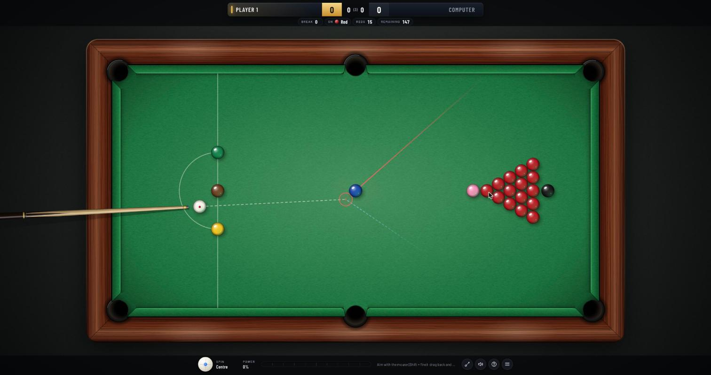

# Snooker

A full-size snooker game for the browser, written in JavaScript with p5.js and Matter.js. Play a match against a computer opponent at three skill levels, or against a friend on the same screen.

**Play it:** https://dawood2k1.github.io/snooker-game/



## Features

- **Physics:** ball-to-ball collisions resolved at the exact moment of contact, cushion rebounds, rolling resistance and six pockets.
- **Spin:** screw, follow and stun that take effect after contact, plus side that changes the angle off a cushion.
- **Aiming guide:** a ghost ball, the object ball's path, the cue ball's path after contact, cushion bounces and the target pocket.
- **Rules:** ball on, fouls and penalties, re-spotted colours, clearing the colours in order, a re-spotted black for tied frames, and best-of matches.
- **Computer opponent:** finds every pot on the table, estimates its chance of making each one, and tests the best candidates at several weights and spins on a private copy of the table. It then plays the pot that leaves the best position, or a safety when nothing is on. Amateur, Pro and Champion levels change how many options it weighs and how accurately it cues.
- **Table layouts:** a standard 15-red rack, scattered reds, or free play with every ball placed at random.
- **Sound:** ball clicks, cushions, cue strikes, pockets and applause, generated in the browser.

## Controls

| Input | Action |
| --- | --- |
| Mouse | Aim the cue (hold Shift, or use the wheel, for fine aim) |
| Drag back, release | Set power and strike |
| ← → | Nudge the aim (Shift for bigger steps) |
| ↑ ↓, then Space | Set power, then strike |
| W A S D, C | Move the tip on the cue ball for spin; C to centre |
| Click in the D | Place the cue ball when it's in hand (R to pick it up again) |
| G / M | Toggle the aiming guide / sound |
| 1 2 3 | Re-rack: standard, scattered reds, free play |
| H | Show all controls |
| Esc | Cancel a shot or open the menu |

## Run it locally

No build step. Serve the folder with any static server and open it in a browser:

```bash
python3 -m http.server 8000
```

Then go to http://localhost:8000. p5.js and Matter.js load from a CDN.

## Code layout

| File | What it does |
| --- | --- |
| `snooker.js` | Game loop, input, turn flow |
| `js/physics.js` | Ball motion, collisions, spin |
| `js/rules.js` | Snooker rules, fouls, scoring, frames and matches |
| `js/ai.js` | Computer opponent |
| `js/renderer.js` | Table, balls, cue and aiming guide |
| `js/hud.js` | Menus, scoreboard, spin pad and power bar |
| `js/audio.js` | Sound effects |
| `js/config.js` | Table dimensions and physics constants |
